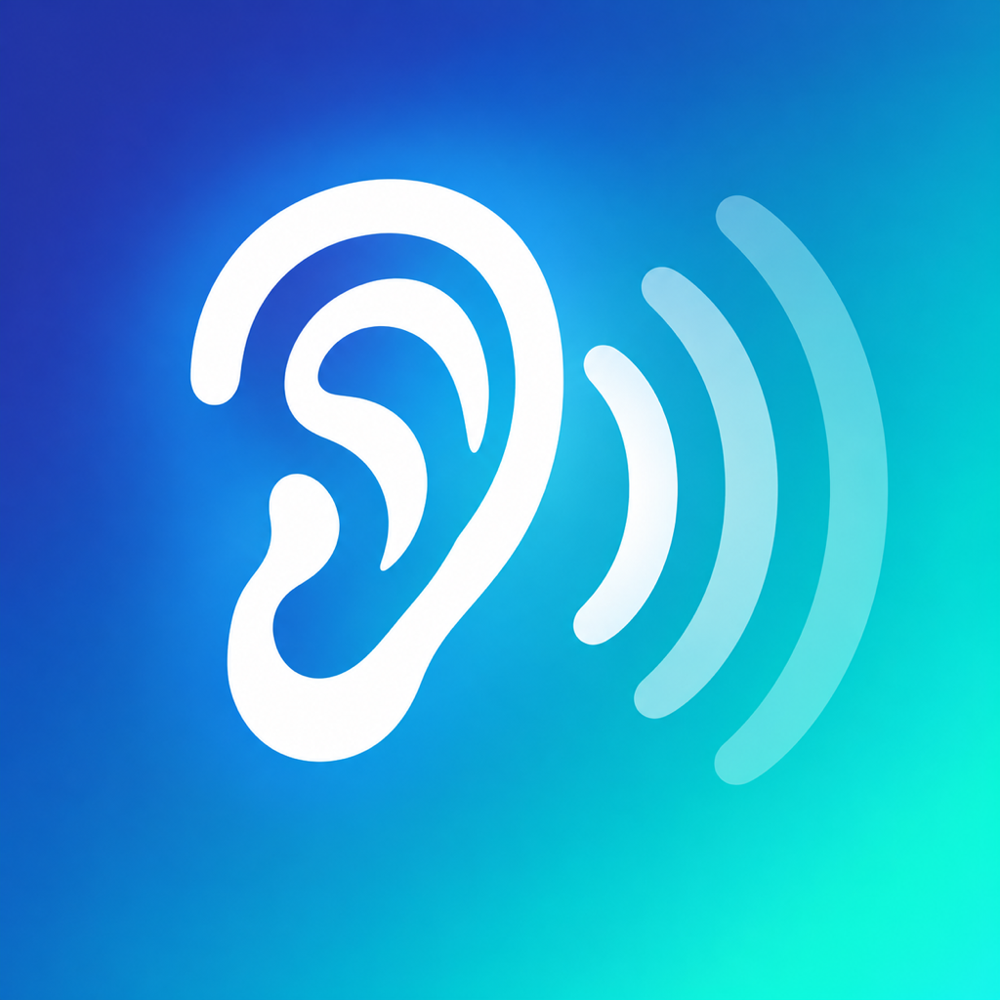
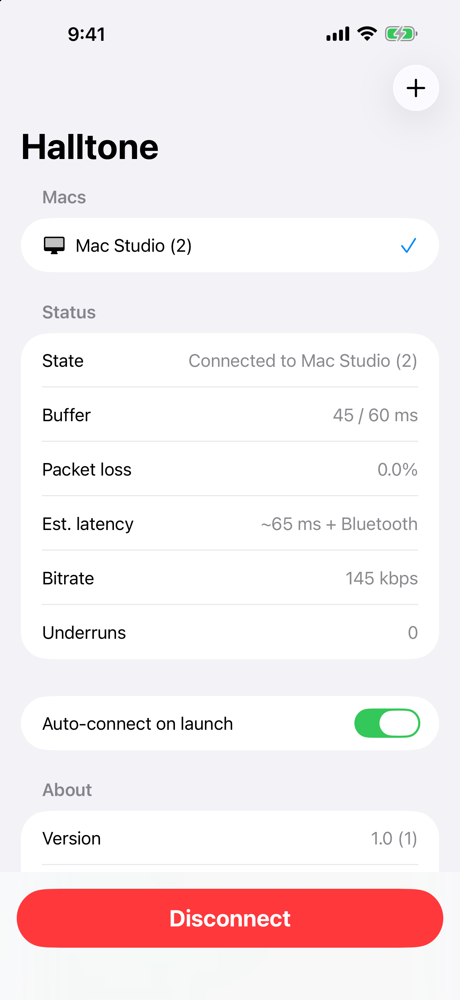
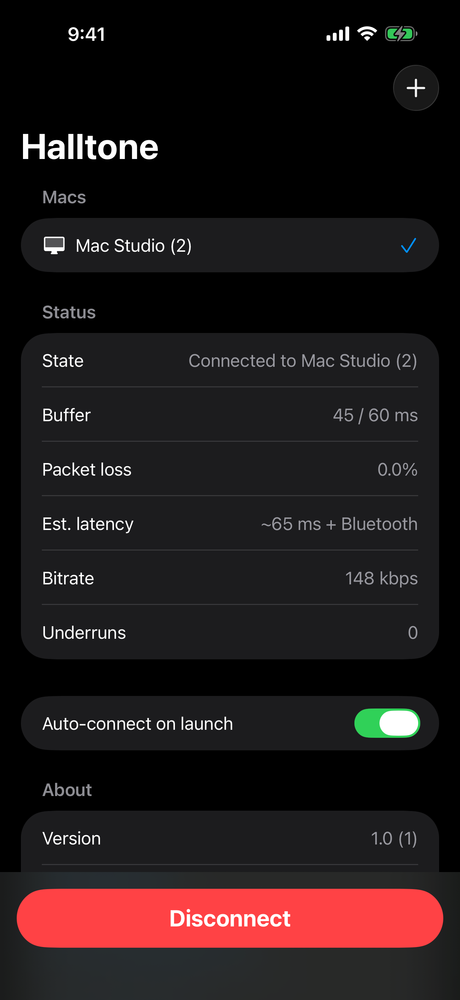

# Halltone



**Stream your Mac's audio to your iPhone over Wi‑Fi.** Leave a video or playlist running on the
Mac, put the phone in your pocket, and keep listening on your AirPods (or any headphones on the
phone) anywhere your Wi‑Fi reaches. Bluetooth drops out a few rooms from the Mac; the phone in
your pocket doesn't.

- About 100 ms of latency on a good network, plus your headphones' own delay
- Reconnects by itself after Wi‑Fi dead spots, keeps playing with the screen locked
- Opus or uncompressed audio; play/pause and skip on the Mac from the lock screen
- Local network only: no accounts, no cloud, no data collection ([privacy policy](PRIVACY.md))

<p>


</p>

## Get it

- **Mac** (macOS 14.2+): download `Halltone.dmg` from [Releases](https://github.com/cmortuus/halltone/releases/latest),
  open it, and drag Halltone to Applications. It lives in the menu bar and shows a pairing code.
- **iPhone** (iOS 17+): App Store, coming soon. Or build it yourself (below).

Both devices need to be on the same local network. See [Setup notes](#setup-notes) for AirPods tips.

## Listening away from home (cellular)

Halltone never opens your Mac to the internet: its audio stream is unencrypted and the pairing code
is short. To listen over cellular, connect the iPhone to your home network with a VPN, then use
Halltone as usual:

- **UniFi**: enable the built-in WireGuard VPN server (Settings → VPN → VPN Server), add the
  profile to the WireGuard app on your iPhone, and turn on "On-Demand" for cellular.
- **Tailscale**: install it on the Mac and the iPhone and sign both into the same tailnet. The
  Mac app advertises its Tailscale address alongside its LAN address; open Halltone on the phone
  once at home so it learns it. Away from home the phone connects to the Tailscale address, and
  if you walk out of Wi-Fi range while listening it switches over by itself. (You can also add
  the Mac's Tailscale address or MagicDNS name by hand with **+**.)

The phone remembers each Mac's address from home, so it connects over the VPN even though Bonjour
discovery doesn't work there. On cellular it automatically switches to a larger buffer (about
0.3–2 s, adapting to the connection) and stops its Wi‑Fi keep-awake packets. Data use at the
default Opus quality is about 60 MB per hour.

## How it works

```
Mac: process tap → ring → Opus/PCM → UDP ──LAN──▶ iPhone: jitter buffer → decode/PLC → AVAudioEngine → AirPods
```

The Mac **advertises and listens** (`_halltone._udp`, port 47800); the phone **browses and subscribes**.
The Mac only captures audio while a subscriber is alive.

## Layout

| Path | What |
|---|---|
| `Packages/HalltoneCore` | SwiftPM package shared by both apps and the CLI: `HalltoneCore` (wire format, codecs, jitter buffer, ring), `HalltoneSender` (macOS capture + UDP listener), `HalltoneReceiver` (UDP subscriber, decode pump, AVAudioEngine playback), vendored libopus (`COpus`). |
| `HalltoneMac` | macOS menu bar app (SwiftUI `MenuBarExtra`). |
| `HalltonePhone` | iOS app. |
| `Tools/halltone-cli` | macOS test tool: capture to WAV, loopback sender/receiver, impairment simulation, latency report. |
| `project.yml` | XcodeGen spec → `xcodegen generate` → `Halltone.xcodeproj`. |

## Build from source

Requirements: macOS 14.2+ (process taps), Xcode 16+, XcodeGen (`brew install xcodegen`).

```bash
xcodegen generate
open Halltone.xcodeproj      # schemes: HalltoneMac, HalltonePhone
```

Signing uses the Apple Development team in `project.yml` (`DEVELOPMENT_TEAM`). A free Apple ID
works for local builds (re-sign every 7 days).

Release DMG (Developer ID signed + notarized): `scripts/release-mac.sh` (see the prerequisites at
the top of the script; `--skip-notarize` for a local test build).

Without Xcode's IDE, the Mac app and CLI also build with SwiftPM:

```bash
HalltoneMac/make-bundle.sh --run        # builds and launches HalltoneMac/.build/Halltone.app
cd Tools/halltone-cli && swift build -c release
scripts/test-core.sh                   # unit tests for HalltoneCore
```

The iPhone app needs Xcode (`xcodebuild -scheme HalltonePhone -destination 'generic/platform=iOS'`
or Run from the IDE with the phone selected).

## Setup notes

1. **AirPods automatic switching will fight this.** If the AirPods are paired to both the Mac and
   the iPhone they may jump back to the Mac when it plays audio. On the Mac: System Settings →
   Bluetooth → AirPods ⓘ → *Connect to This Mac: "When Last Connected to This Mac"*. Do the same on
   the iPhone if needed.
2. Intended workflow: at the desk, AirPods connect directly to the Mac (no delay). When leaving,
   open Halltone on the phone and tap **Connect**, then move the AirPods to the phone
   (Control Center → AirPlay icon → AirPods).
3. Grant **System Audio Recording** on the Mac (System Settings → Privacy & Security → Screen &
   System Audio Recording) and **Local Network** on both devices. The Mac app shows a shortcut
   to the setting in its menu if capture fails. Without the permission the tap delivers silence.
4. If the phone can't see the Mac, check that both are on the same VLAN or enable mDNS in UniFi,
   or add the Mac by IP with the **+** button.
5. The Mac shows a 4‑digit **pairing code** in its menu; the phone asks for it once per Mac and
   stores it in the Keychain.
6. Lock-screen play/pause/next/previous send CONTROL messages; the Mac relays them as media keys,
   which needs the **Accessibility** permission (prompted on first use).

## Wire protocol (v1)

Big-endian, one datagram per message, ≤1200 bytes. 12-byte header: magic `0x4854`, version `1`,
type, seq (u32), session (u32). Types:

| Type | Direction | Payload / meaning |
|---|---|---|
| SUBSCRIBE 0x01 | phone → Mac | pairing code, device name, optional device ID (lets the Mac move a phone to a new address, e.g. Wi‑Fi ↔ VPN, instead of adding a second subscriber) |
| KEEPALIVE 0x02 | phone → Mac | every 1 s: last seq, loss ‰, buffer ms. Mac drops a phone after 20 s without one |
| BYE 0x03 | phone → Mac | leaving (the Mac stops capturing and unmutes at once) |
| SUBSCRIBE_ACK 0x04 | Mac → phone | codec, rate, channels, frame size, Mac name |
| SUBSCRIBE_NAK 0x05 | Mac → phone | 1 = wrong pairing code; 2 = not subscribed (Mac restarted or timed the phone out): subscribe again |
| STATUS 0x06 | Mac → phone | flags: controls available, last control failed, can hold headphones, user at Mac, recent input, explicit play/pause, playing |
| NUDGE 0x07 | phone → Mac | tiny uplink packet every 20 ms on Wi‑Fi, keeps the phone's radio out of power save |
| RESEND 0x08 | phone → Mac | up to 64 missing `samplePos` values; the Mac resends from a 256-packet history |
| AUDIO 0x10 | Mac → phone | `samplePos u64, codec u8, len u16, payload` |
| CONTROL 0x20 | both | play/pause, next, previous, hold headphones on/off, pause, play, listening, not listening |

Codecs: 1 = PCM16 interleaved stereo (240-sample / 5 ms frames, ~1.5 Mbps); 2 = Opus 48 kHz stereo
(480-sample / 10 ms frames, 128 kbps VBR, restricted-low-delay, in-band FEC flag on).

The Mac replies from whichever of its addresses the phone sent to (`IPV6_PKTINFO` in,
`IP_PKTINFO` out, `CHalltone/udp_pktinfo.c`). A Mac on Ethernet and Wi‑Fi has two addresses on
one subnet; a plain `sendto` picks the source by route, and the phone's connected socket drops
replies from an address it didn't contact.

Phone logs (TCP 47801): `HTLOG1 <pairing code> <bytes> <base64 phone name>\n` then the file; the
Mac answers `OK` or `NO <reason>`.

## Receiver behavior

- **Latency modes.** Auto (default) uses Lowest while you're at the Mac and Stable when you're
  away. "At the Mac" comes from Bluetooth signal strength to the Mac's beacon (median of 5,
  calibrated while you're typing), else from the Mac's own "someone is using me" flag. Lowest:
  40 ms start, 20–250 ms, no gap concealment (it sounded worse than waiting). Stable: 300 ms
  start, 250–1500 ms. Cellular: 400 ms start, 300–2000 ms. Mode changes retune the depth with
  crossfaded drops/repeats instead of flushing.
- **Jitter buffer** slotted by `samplePos`: handles reorder and duplicates. The target follows the
  recent peak arrival gap plus a margin. Underruns raise it only when the queue was actually
  empty, and gaps longer than the ceiling are ignored, so a single blackout can't ratchet it up.
  Clock drift drops or repeats one frame with a crossfade. A jump beyond the ceiling flushes and
  re-primes.
- **Retransmission.** Holes are requested with RESEND while there's still time to play them
  (recovers nearly everything at 5% simulated loss).
- **Screen lock.** About 2.5 s after the screen locks, iOS pulls ~100–130 ms of audio ahead for a
  deeper output buffer, and gives it back for ~2 s after unlock. On lock the buffer grows to at
  least 150 ms before that pull arrives, then shrinks back after unlock. Without this the lock
  popped.
- **Reconnect.** No AUDIO for 1.5 s → "Reconnecting…", SUBSCRIBE every second and a new socket
  every 10 s; the audio engine keeps running so iOS doesn't suspend the app. Wi‑Fi interface
  changes recreate the socket. A Mac that doesn't know the phone answers its keepalive with NAK 2,
  and the phone subscribes again within a second.
- **Pausing.** Headphones out, CarPlay/AirPlay/speaker output, or another app's audio pauses the
  stream (only personal outputs play: Bluetooth, wired, USB), keeping the subscription for 30 min
  (10 min for interruptions). While every phone is paused the Mac stops capturing. A headphone
  press is told apart from removal (removal changes the route within 600 ms).
- **iOS audio server restarts** (media services reset) rebuild the session and engine even while
  idle; an engine that still won't start is replaced once before reporting an error.

## Testing

```bash
cd Tools/halltone-cli && swift build -c release && CLI=.build/release/halltone-cli

$CLI capture --seconds 10 out.wav                 # M0: process tap → WAV (play something first)
$CLI send --source tone --codec opus --no-bonjour # loopback sender with a synthetic 440 Hz tone + 1/s click
$CLI receive 127.0.0.1:47800 --wav rx.wav --seconds 10
$CLI analyze rx.wav                               # RMS, dominant frequency, silent gaps

# Impairment (no Network Link Conditioner needed) + latency report:
$CLI send --source tone --codec opus --no-bonjour --sim-loss 0.05 --sim-jitter 40 --latency-log s.csv
$CLI receive 127.0.0.1:47800 --wav rx.wav --seconds 20 --latency-log r.csv
$CLI latency s.csv r.csv
```

The latency report measures encode → scheduled-at-sink inside one Mac (same clock). Add the
capture IO buffer (~5–10 ms) and the output device latency on top. Measured on loopback: ~55 ms
on a clean link once the target has decayed to 30 ms, ~93 ms with 5% loss and 40 ms jitter.

For the real Mac → iPhone path, the phone's status screen shows buffer depth and an estimated
latency (buffer + hand-off ring + ~20 ms output), which is the rough check the spec asks for.

## Notes for maintainers

- Both audio callbacks (the tap IOProc on the Mac and the source node render block on the phone)
  only copy to/from a lock-free ring (`CHalltone/ring_buffer.c`). Encoding and decoding happen on
  dedicated high-priority threads.
- **Opus**: libopus 1.5.2 is vendored under `Packages/HalltoneCore/Sources/COpus/opus` as a plain
  float build (no NEON/x86 intrinsics). A spike showed AudioToolbox on macOS 27 also offers Opus
  encode/decode through `AVAudioConverter` (even PLC with an empty packet) but no FEC control, and
  iOS availability wasn't verified, so libopus stays.
- Logs: `log stream --predicate 'subsystem == "com.halltone"'`.
- Debug-only hooks (compiled out of Release): the `-pairingCode` launch argument /
  `HALLTONE_PAIRING_CODE` for automated Simulator runs. `-logShipBytes N` lowers the phone's
  log-upload size for testing.

### Diagnostics

- **Phone:** `Documents/halltone.log`: state changes, routes, interruptions, engine restarts,
  lock/unlock render rates, and a stats line every 10 s. While packets are short or playback
  underruns it logs every second. Pull it with `scripts/phone-log.sh` (development builds); users
  share it from About → Share diagnostics log. At 25 MB the file moves to `Documents/LogOutbox/`
  (capped at 100 MB) and is uploaded to the Mac the phone is connected to.
- **Mac:** uploaded phone logs land in `~/Library/Logs/Halltone/Phones/<phone>/`, oldest deleted
  beyond 5 GB. The app logs to the unified log (`/usr/bin/log show --predicate 'subsystem ==
  "com.halltone"' --info`; in zsh `log` is a builtin). Every 10 s it logs each phone's own view
  (buffer, loss, nudges, max gap; a low nudge count means the phone stopped hearing the Mac) and,
  once a second, any audio sends the kernel refused.
- **Reading a dropout:** "subscriber moved" twice ~10 s apart on the Mac while the phone says
  "reconnecting" means the phone's packets reach the Mac but nothing gets back.
- App Store material (listing copy, review notes, privacy answers, screenshots) is in
  `docs/app-store/`.

## Status and known issues

Verified end to end on a real iPhone 15 Pro (iOS 27) with AirPods Pro: Bonjour discovery, pairing,
background playback, automatic reconnect after Mac app restarts, and AirPods moving between the
Mac and the phone without dropouts or distortion. Not yet run: the desk-to-garage walk test and
the 1-hour locked-screen test.

Lessons that shaped the design:

- **Tap start.** A tap aggregate that includes the output device blocks until that device is
  awake and something plays. The aggregate is tap-only, and a silent `SilenceKeeper` engine keeps
  a writer alive so IO starts in ~150 ms.
- **Never hold the headphones from the Mac.** The silence keeper must play to the built-in
  speakers (or another wired output), not the default device: when the default output is AirPods
  that the user moved to the phone, a Mac-side stream to them makes the two devices fight over
  the AirPods (route flapping on the phone, distorted audio).
- **Bluetooth render callbacks are large.** iOS can ask for 1024–4096 frames per callback over
  Bluetooth. The decode pump keeps at least one full callback (plus a frame) decoded ahead;
  otherwise every callback underruns and the jitter target ratchets up to 250 ms.
- **Output device changes** (AirPods moving) swap the tap underneath a running encoder, which
  pads with silence, so subscribers see no gap and `samplePos` stays continuous.
- **Headroom.** Program audio often hits full scale; the phone soft-limits above −0.9 dBFS.
- **Mute while streaming** is on by default: the tap mutes the Mac's output only while capturing
  for a listening phone, so you don't hear a delayed echo from the Mac.
- **AirPods and several Macs.** macOS automatic switching lets any of the user's Macs take the
  AirPods when it plays. While listening, the phone asks every Halltone Mac on the network to
  guard them; a Mac that grabs them switches back to its speakers and drops its Bluetooth link.
  Only the streaming Mac presses play afterwards. A hold request from a phone that says it's
  paused never counts.
- **One-way Wi‑Fi outages.** On a UniFi network with the Mac on Wi‑Fi, the phone sometimes stopped
  receiving for ~30 s while its own packets still reached the Mac. The Mac's Wi‑Fi reported every
  frame delivered and no sends failed, which points at the access point side, likely roaming.
  Putting the Mac on Ethernet is the suggested fix (still being verified).
- **AirPods dropping off the phone** every minute or two showed up as "route change 2 → Speaker"
  with neither Mac taking them. That's the AirPods (ear detection, case, battery), not Halltone.

Sender CPU while streaming Opus: ~3.5% (CLI) / ~3.9% (menu bar app), down from ~8% after moving to
a raw UDP socket with a preallocated datagram. Idle: ~0%.

Testing tips:

- Both apps' processes are named `Halltone`; when the Simulator is running, kill the Mac app by
  path (`pkill -f Halltone.app/Contents/MacOS/Halltone`), not by name.
- Headless Simulator run: build the HalltonePhone scheme for `generic/platform=iOS Simulator`,
  `xcrun simctl install <udid> …/Halltone.app`, then
  `xcrun simctl launch <udid> com.halltone.phone -pairingCode <code> -lastMac "bonjour:<Mac name>"`
  (the `-pairingCode` launch argument stands in for the Keychain; `-lastMac` triggers
  auto-connect). `xcrun simctl io <udid> screenshot out.png` shows the status screen.
- Device install: connect the iPhone (USB or paired over Wi‑Fi), select it in Xcode and run the
  HalltonePhone scheme, or `xcodebuild -scheme HalltonePhone -destination 'platform=iOS,name=<phone>'`.

## License

Copyright (C) 2026 the Halltone authors.

Halltone is free software: you can redistribute it and/or modify it under the terms of the
[GNU General Public License](LICENSE) as published by the Free Software Foundation, either
version 3 of the License, or (at your option) any later version. It is distributed in the hope
that it will be useful, but WITHOUT ANY WARRANTY; see the license for details.

Bundled third-party code keeps its own license: libopus (BSD-3-Clause), in
`Packages/HalltoneCore/Sources/COpus/opus/COPYING`.

Contributions are welcome; see [CONTRIBUTING.md](CONTRIBUTING.md).

