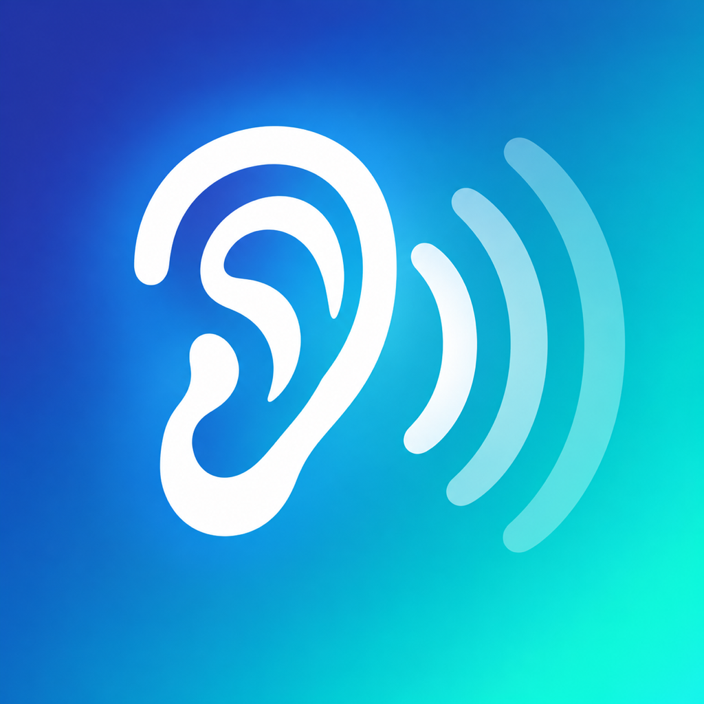
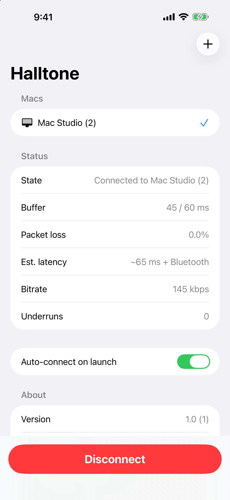
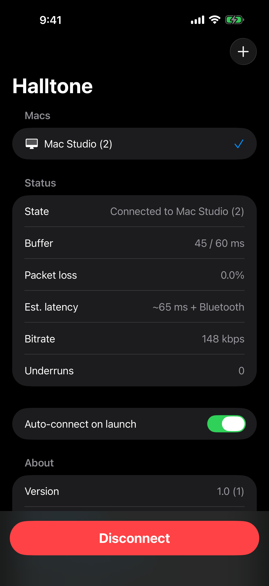

# Halltone



**Stream your Mac's audio to your iPhone over Wi‑Fi.** Leave a video or playlist running on the
Mac, put the phone in your pocket, and keep listening on your AirPods (or any headphones on the
phone) anywhere your Wi‑Fi reaches. Bluetooth drops out a few rooms from the Mac; the phone in
your pocket doesn't.

- About 100 ms of latency on a good network (Game mode: 40–55 ms), plus your headphones' own delay
- Reconnects by itself after Wi‑Fi dead spots, keeps playing with the screen locked
- Opus or uncompressed audio; play/pause and skip on the Mac from the lock screen
- Local network only: no accounts, no cloud, no data collection ([privacy policy](PRIVACY.md))

<p>


</p>

## Get it

- **Mac** (macOS 14.2+): download `Halltone.dmg` from [Releases](https://github.com/cmortuus/halltone/releases/latest),
  open it, and drag Halltone to Applications. It lives in the menu bar and shows a pairing code.
- **iPhone** (iOS 17+): App Store, coming soon. Or build it yourself (below).

Both devices need to be on the same local network. See [Setup notes](#setup-notes) for AirPods tips.

## Listening away from home (cellular)

Halltone never opens your Mac to the internet: its audio stream is unencrypted and the pairing code
is short. To listen over cellular, connect the iPhone to your home network with a VPN, then use
Halltone as usual:

- **UniFi**: enable the built-in WireGuard VPN server (Settings → VPN → VPN Server), add the
  profile to the WireGuard app on your iPhone, and turn on "On-Demand" for cellular.
- **Tailscale**: install it on the Mac and the iPhone and sign both into the same tailnet. The
  Mac app advertises its Tailscale address alongside its LAN address; open Halltone on the phone
  once at home so it learns it. Away from home the phone connects to the Tailscale address, and
  if you walk out of Wi-Fi range while listening it switches over by itself. (You can also add
  the Mac's Tailscale address or MagicDNS name by hand with **+**.)

The phone remembers each Mac's address from home, so it connects over the VPN even though Bonjour
discovery doesn't work there. On cellular it automatically switches to a larger buffer (about
0.3–2 s, adapting to the connection) and stops its Wi‑Fi keep-awake packets. Data use at the
default Opus quality is about 60 MB per hour.

## How it works

```
Mac: process tap → ring → Opus/PCM → UDP ──LAN──▶ iPhone: jitter buffer → decode/PLC → AVAudioEngine → AirPods
```

The Mac **advertises and listens** (`_halltone._udp`, port 47800); the phone **browses and subscribes**.
The Mac only captures audio while a subscriber is alive.

## Layout

| Path | What |
|---|---|
| `Packages/HalltoneCore` | SwiftPM package shared by both apps and the CLI: `HalltoneCore` (wire format, codecs, jitter buffer, ring), `HalltoneSenderCore` (the portable sender: UDP listener, pairing, subscribers, STATUS, RESEND, encode loop; macOS and Linux), `HalltoneSender` (macOS glue: process tap, Bonjour, resampling), `HalltoneReceiver` (UDP subscriber, decode pump, source manager, AVAudioEngine playback of the mix bus), vendored libopus (`COpus`). |
| `Packages/HalltoneDialog` | Standalone SwiftPM package (no Apple frameworks; macOS + Linux): real-time **dialog detector** for 48 kHz stereo game audio (center extraction + vendored libfvad + level/band/modulation gates + hysteresis), and the `halltone-dialog-eval` tool. See its [README](Packages/HalltoneDialog/README.md). |
| `HalltoneMac` | macOS menu bar app (SwiftUI `MenuBarExtra`). |
| `HalltonePhone` | iOS app. |
| `Linux/halltone-linux` | The Ubuntu sender (`halltone-linux`): PulseAudio/PipeWire capture + Avahi on top of `HalltoneSenderCore`, `install.sh`, systemd user unit. See [Linux (Ubuntu) sender](#linux-ubuntu-sender). |
| `Tools/halltone-cli` | macOS test tool: capture to WAV, loopback sender/receiver, impairment simulation, latency report, acoustic end-to-end latency (`measure`). |
| `project.yml` | XcodeGen spec → `xcodegen generate` → `Halltone.xcodeproj`. |

## Build from source

Requirements: macOS 14.2+ (process taps), Xcode 16+, XcodeGen (`brew install xcodegen`).

```bash
xcodegen generate
open Halltone.xcodeproj      # schemes: HalltoneMac, HalltonePhone
```

Signing uses the Apple Development team in `project.yml` (`DEVELOPMENT_TEAM`). A free Apple ID
works for local builds (re-sign every 7 days).

Release DMG (Developer ID signed + notarized): `scripts/release-mac.sh` (see the prerequisites at
the top of the script; `--skip-notarize` for a local test build).

Without Xcode's IDE, the Mac app and CLI also build with SwiftPM:

```bash
HalltoneMac/make-bundle.sh --run        # builds and launches HalltoneMac/.build/Halltone.app
cd Tools/halltone-cli && swift build -c release
scripts/test-core.sh                   # unit tests for HalltoneCore
```

The iPhone app needs Xcode (`xcodebuild -scheme HalltonePhone -destination 'generic/platform=iOS'`
or Run from the IDE with the phone selected).

**Linux (Ubuntu 24.04):** the portable core (`HalltoneCore`: wire format, codecs, jitter buffer,
ring, vendored libopus) and `HalltoneSenderCore` (the portable sender) build and test with a Swift 6.x
toolchain (e.g. the `swift:6.1-noble` image or [swiftly](https://www.swift.org/install/linux/)).
`HalltoneSender` / `HalltoneReceiver` and the apps are Apple-only and are left out of the package on
Linux; the Linux sender is its own package, see below:

```bash
cd Packages/HalltoneCore && swift build && swift test
```

`Packages/HalltoneDialog` (the dialog detector) is a separate package that builds and tests the same way on
macOS and Linux; on Ubuntu install `espeak-ng` so its speech tests run instead of skipping.

CI (`.github/workflows/ci.yml`) runs this on Ubuntu 24.04 plus `scripts/test-core.sh` on macOS, and builds and tests `halltone-linux` (including a run against a real PulseAudio server).

## Setup notes

1. **AirPods automatic switching will fight this.** If the AirPods are paired to both the Mac and
   the iPhone they may jump back to the Mac when it plays audio. On the Mac: System Settings →
   Bluetooth → AirPods ⓘ → *Connect to This Mac: "When Last Connected to This Mac"*. Do the same on
   the iPhone if needed. The phone's **Keep headphones on this iPhone** setting (on by default)
   also has every Halltone Mac hand the AirPods back while the phone listens; the Mac asks for
   Bluetooth access the first time it does.
2. Intended workflow: at the desk, AirPods connect directly to the Mac (no delay). When leaving,
   open Halltone on the phone and tap **Connect**, then move the AirPods to the phone
   (Control Center → AirPlay icon → AirPods).
3. Grant **System Audio Recording** on the Mac (System Settings → Privacy & Security → Screen &
   System Audio Recording) and **Local Network** on both devices. The Mac app shows a shortcut
   to the setting in its menu if capture fails. Without the permission the tap delivers silence.
4. If the phone can't see the Mac, check that both are on the same VLAN or enable mDNS in UniFi,
   or add the Mac by IP with the **+** button.
5. The Mac shows a 4‑digit **pairing code** in its menu; the phone asks for it once per Mac and
   stores it in the Keychain.
6. Lock-screen play/pause/next/previous send CONTROL messages; the Mac relays them as media keys,
   which needs the **Accessibility** permission (prompted on first use).

## Linux (Ubuntu) sender

`halltone-linux` streams an Ubuntu PC's audio (a gaming rig, say) to the phone the same way the Mac
does: the phone finds it with Bonjour, pairs with a 4-digit code and gets the same AUDIO, KEEPALIVE,
RESEND and STATUS behavior. It defaults to **Game mode**: PCM in 2.5 ms frames.

**Install** (Ubuntu 22.04 / 24.04, a Swift 6.x toolchain such as [swiftly](https://www.swift.org/install/linux/)):

```bash
git clone https://github.com/cmortuus/halltone && cd halltone
Linux/install.sh
```

`install.sh` builds a release binary, installs it to `~/.local/bin/halltone-linux` and a systemd
**user** unit `halltone.service` that runs it at login. It needs `libpulse-dev` and `pkg-config`
(to build), `avahi-utils` (so the phone discovers the PC) and `pulseaudio-utils` (`pactl`, so capture
follows a change of default output); it says which are missing and runs `sudo apt-get install` only
if you answer yes (`--yes` skips the question, `--no-service` installs the binary only,
`--uninstall` removes it). The first start prints a pairing code and saves it in the config:

```bash
journalctl --user -u halltone -n 20      # banner: name, pairing code, codec
```

On the iPhone, open Halltone: the PC appears by its hostname; enter the code once. If it doesn't
appear (no `avahi-utils`, Avahi stopped, or mDNS blocked on the network) add it by IP with **+**.
If `ufw` is enabled, allow the stream in: `sudo ufw allow 47800/udp` (and `5353/udp` for mDNS).

**Install from the apt repo** (Ubuntu 24.04, amd64 or arm64; no Swift toolchain needed). The `.deb`
is built in CI (`linux-v*` tags) and imported into a self-hosted apt repo on the LAN. The host
below is a placeholder that a later reviewer may adjust:

```bash
sudo curl -fsSL http://apt.lan/halltone/halltone-archive-keyring.gpg -o /usr/share/keyrings/halltone-archive-keyring.gpg
echo "deb [signed-by=/usr/share/keyrings/halltone-archive-keyring.gpg] http://apt.lan/halltone noble main" | sudo tee /etc/apt/sources.list.d/halltone.list
sudo apt update && sudo apt install halltone-linux
systemctl --user daemon-reload && systemctl --user enable --now halltone   # the package doesn't enable it for you
```

The package installs `/usr/bin/halltone-linux` and a user unit; the pairing code is in
`journalctl --user -u halltone -n 20`. After an upgrade run `systemctl --user restart halltone`.
`Linux/install.sh` above remains the build-from-source path. To build the package yourself:
`Linux/packaging/build-deb.sh <version>`.

**How it works.** Capture uses the PulseAudio simple API from `@DEFAULT_MONITOR@` (whatever the
default output plays) at 48 kHz float32 stereo with 2.5 ms fragments. That works on PipeWire through
`pipewire-pulse`, Ubuntu's default. The reader reconnects if the audio server restarts, and
switches within about two seconds when the default sink changes. While nothing plays it sends paced
silence, like the Mac. The service is advertised by running `avahi-publish-service` with the same
TXT record as the Mac (`name`, `v`, `port`, plus `addr`, the wired interface's IPv4 so the phone
doesn't pick a Docker or VPN address, and `ts`, the Tailscale address).

**Config**: `~/.config/halltone/config.json` (created on first run); command-line flags override it.

```json
{ "name": "Gaming PC", "pairingCode": 4821, "codec": "pcm", "frameMs": 2.5, "port": 47800 }
```

| key / flag | meaning |
| --- | --- |
| `name` / `--name` | name the phone shows (default: hostname) |
| `pairingCode` / `--code` | 1000-9999; generated on first run and printed |
| `codec` / `--codec` | `pcm` (default, lowest latency) or `opus` (10 ms frames, less Wi-Fi bandwidth) |
| `frameMs` / `--frame-ms` | PCM frame size, `2.5` (Game mode, default) or `5` |
| `port` / `--port` | UDP port, default 47800 |
| `advertise` / `--no-advertise` | publish over Avahi (default on) |
| `pulseDevice` / `--device` | PulseAudio source to record, default `@DEFAULT_MONITOR@` |
| `--source tone` | built-in 440 Hz test tone instead of PulseAudio (no audio server needed) |
| `--source wav:<file>` | plays a WAV file once in real time (test input; used by the dialog-pause tests) |
| `media.player` / `--media-player` | pin the MPRIS player the controls act on (substring of its bus name or identity, e.g. `firefox`) |
| `media.ignore` / `--media-ignore` | list (flag: comma-separated) of players never touched, e.g. a game that registers MPRIS |
| `allowRemoteControl` / `--no-remote-control` | let paired devices pause and resume this PC's player (default on) |
| `dialogPause.*` / `--dialog-*` | pause the video (on a Mac, or on this PC) during game dialog, see below (off by default) |

`halltone-linux --help` lists everything. Restart after editing the config:
`systemctl --user restart halltone`.

**Media controls (MPRIS).** The PC controls its own player the way the Mac does with media keys,
over the D-Bus session bus with `busctl --user` (ships with systemd, nothing to install). Firefox,
Chrome/Chromium (YouTube), mpv, VLC, Spotify and others implement MPRIS.

- **Phone lock screen.** play/pause, next and previous (and the explicit pause/play the phone
  sends when headphones come out) drive the chosen player. STATUS reports `controlsAvailable`
  while an MPRIS player exists, and its playing flag comes from the player's real
  `PlaybackStatus`, so the phone's multi-source logic picks the PC as the media source by itself.
  Unlike the Mac this never toggles blindly: pause on a paused player is a no-op.
- **Remote pause.** The PC is a REMOTE_CONTROL *target* too (`halltone-cli remote <pc> --code N
  pause|resume`, or another paired device): the same `RemoteControlCoordinator` rules as the Mac
  (see "Remote pause" below), on MPRIS. Pause only if a player is `Playing`; resume only that
  player, only if it is still `Paused` on the same track, within 10 minutes, and the same peer
  paused it. The user pressing play, changing track or closing the player ends the pause.
  `allowRemoteControl: false` answers `disabled`.
- **Which player.** The one that is `Playing`; with several, the one that started most recently.
  When none plays, the last one used, else the first by name. `media.player` pins one (substring
  of the bus name or identity, case-insensitive; no match means no controls), `media.ignore` excludes
  some. Example: `"media": { "player": "firefox", "ignore": ["steam"] }`.
- **CLI** (talks to D-Bus directly, no daemon needed; honors `--config`, `--media-player`,
  `--media-ignore`): `halltone-linux players` lists players with status and marks the one that is
  controlled or ignored; `halltone-linux media pause|play|toggle|next|previous|status`.

In code, `MediaController` (`Linux/halltone-linux/Sources/HalltoneLinuxKit/MediaController.swift`)
is the single owner of this and also implements `ExplicitPlaybackEnvironment`, the explicit-state
variant of `RemoteControlEnvironment` (real state plus Pause/Play, no audio probing) that
`RemoteControlCoordinator` uses when the environment offers it. The Mac still takes the
audio-and-toggle path, unchanged.

**Differences from the Mac sender.** No headphone holds and no "user at the PC" flag: those stay
Mac-side features of the same sender core. Without a D-Bus session bus (a headless box) controls
are reported unavailable and REMOTE_CONTROL answers `no player` (`notPlaying`). The other direction,
the PC asking the Mac to pause, is the next section.

**Latency.** On PipeWire the 2.5 ms fragment is a request: the graph's quantum (default 1024 frames,
21 ms) is lowered to the smallest any client asks for, which this stream does while it runs. If the
phone's buffer readout stays high, try a fixed small quantum
(`pw-metadata -n settings 0 clock.force-quantum 128`; `0` undoes it).

### Pausing the Mac's video during game dialog

The scenario: you play a game on the Ubuntu PC while a YouTube video plays on the Mac, and the phone
mixes both into your headphones. While a character talks, `halltone-linux` asks the Mac to pause the
video (REMOTE_CONTROL `pauseForPeer`), and when the dialog is over it asks the Mac to resume
(`resumeForPeer`). The Mac only resumes if nothing changed in between: if you touched playback
yourself, it leaves it alone and answers `resumeSkipped` (see [Remote pause](#remote-pause-remote_control)).

**Set it up** (it is off until you turn it on):

1. On the Mac, Halltone is running and **Let paired devices pause playback** is on (menu, the default).
   Note the Mac's pairing code.
2. On the PC add to `~/.config/halltone/config.json` and `systemctl --user restart halltone`:

   ```json
   { "name": "Gaming PC", "pairingCode": 4821,
     "dialogPause": { "enabled": true, "pairingCode": 7310 } }
   ```

   `dialogPause.pairingCode` is the **Mac's** code (REMOTE_CONTROL is checked against the receiver's
   code; the top-level `pairingCode` is the PC's own, for the phone). With no `dialogPause.mac` the
   PC uses the only other Halltone found by `avahi-browse -rt _halltone._udp` (needs `avahi-utils`);
   if there are several, or none, the log says so and you set `"mac": "Calebs-MacBook.local"`, an IP,
   `"192.168.1.23:47800"` or the Bonjour name shown in the phone's list.

| key / flag | default | meaning |
| --- | --- | --- |
| `dialogPause.enabled` / `--dialog-pause` | `false` | start with dialog pause on |
| `dialogPause.pairingCode` / `--dialog-code` | (required to use it) | the Mac's pairing code |
| `dialogPause.mac` / `--dialog-mac` | the only Halltone Mac found | host, `host:port`, `[v6]:port` or the Bonjour name |
| `dialogPause.minDialogMs` / `--dialog-min-ms` | `600` | speech must still be going this long after it began before the Mac is paused: one-liners ("Hey!") don't pause |
| `dialogPause.resumeDelayMs` / `--dialog-resume-ms` | `1500` | resume this long after the last speech |
| `dialogPause.sourceApp` / `--dialog-app` | (whole monitor) | PulseAudio application name to analyze instead of everything; **required** with `target: "local"` |
| `dialogPause.target` / `--dialog-target` | `mac` | `mac` (the Mac above), `local` (the video on this PC via MPRIS, see [same PC](#dialog-pause-on-the-same-pc)), or a Mac's host |

**Kill switch.** `halltone-linux dialog off` (also `on`, `status`) talks to the running service over
a Unix socket (`$XDG_RUNTIME_DIR/halltone-linux.sock`); `kill -USR1 $(pidof halltone-linux)` flips
it too, handy as a keyboard shortcut. Turning it off while the Mac is paused asks the Mac to resume.
`status` shows the state, the Mac it found and the last answer. A stopped or restarted service also
asks the Mac to resume first.

**Timing to expect.** The detector needs about 0.25 s of speech to say "dialog started" and reports
the end exactly 1.2 s after the last speech. So the video pauses about **0.6 s after a character
starts talking** (`minDialogMs`; never sooner than the detector's own 0.25 s), and resumes about
**1.5 s after the last word** (`resumeDelayMs`, counted from the last speech, so with the default it
is 0.3 s after the detector reports the end; a value under 1200 resumes the moment the end is
reported). If the next line starts before the resume goes out, the video stays paused. Requests are
retried with the same id every 300 ms, up to 5 times.

**Tuning.** Read the decisions back with `journalctl --user -u halltone -f | grep -E 'Dialog'`:

```text
[Dialog] dialog STARTED at stream 12.40 s (known at 12.68 s, detection lag 280 ms) → pause in 320 ms if speech continues (minDialogMs 600)
[Dialog] → pauseForPeer
[Dialog] ← pauseForPeer id 2213590034 to 192.168.1.23:47800: paused (attempt 1, 6 ms)
[Dialog] dialog ENDED at stream 19.10 s (known at 20.30 s, detection lag 1200 ms) → resume in 300 ms (resumeDelayMs 1500)
[Dialog] → resumeForPeer
[Dialog] ← resumeForPeer id 70161911 to 192.168.1.23:47800: resumed (attempt 1, 5 ms)
```

- *Pauses on one-liners or short barks* → raise `minDialogMs` (1000-1500). The log line "speech
  stopped before minDialogMs elapsed: holding off the pause" means the filter worked.
- *Pause comes too late* → lower `minDialogMs` (the floor is the detector's ~0.25 s).
- *Video restarts mid-conversation* (long pauses between a character's sentences) → raise
  `resumeDelayMs`; a new line before the resume goes out keeps it paused. *Resumes too slowly* →
  lower it (under 1200 ms it resumes as soon as the end is detected).
- *Dialog is missed* (no `STARTED` lines while a character clearly talks) → the known limit of the
  detector: dialog at or below the music's loudness is increasingly lost (about 92-96 % of the
  speech found at the same level, worse below; see the [detector README](Packages/HalltoneDialog/README.md)).
  Turn the game's music volume down or its dialog/voice volume up, and play dialog in the center
  (stereo, not hard-panned or with wide reverb). The detector's thresholds are not exposed in the
  config; `halltone-dialog-eval` can replay a recording with different ones.
- *Pauses on something that isn't dialog* → set `sourceApp` and check the log for the lines
  above to see what triggered.
- The answers explain themselves: `notPlaying` (nothing was playing on the Mac, so no resume is
  sent), `badPairingCode` (use the Mac's code), `disabled` (the Mac's switch is off), `failed` (the
  Mac couldn't tell whether it was playing, or lacks Accessibility permission), `resumeSkipped`
  (you changed playback yourself; correct). `NO ANSWER` after 5 tries: Mac not running Halltone, not
  reachable, or the wrong address; discovery is repeated on the next attempt.

**`sourceApp`: analyze one application.** By default the detector listens to the same stream the
phone gets, so voice chat in Discord can look like dialog. Set `dialogPause.sourceApp` to the game's
PulseAudio application name (`pactl list sink-inputs | grep -E 'application.name|binary'`, e.g.
`Cyberpunk2077.exe`; a case-insensitive match on the name, the process binary or the media name,
exact matches preferred, substrings accepted). The phone still receives the full mix.

*Why `parec`:* the PulseAudio *simple* API (what the sender captures with) cannot record a single
playback stream; that is `pa_stream_set_monitor_stream` in the asynchronous API. Rather than add an
async-API capture path, the sender runs `parec --monitor-stream=<sink-input index>` (it is
`pa_stream_set_monitor_stream`; `pulseaudio-utils` is already required for `pactl`), finds the index
with `pactl -f json list sink-inputs` once a second, and restarts `parec` when the stream appears,
changes or ends; until then the detector hears silence. This also works on PipeWire through
`pipewire-pulse`. In this mode dialog pause works even while no phone is listening; in whole-monitor
mode it follows the phone's capture, so the PC only pauses the Mac while the phone is listening.

**Cost.** The detector runs on its own thread from a copy of the captured audio (a ring write per
fragment on the capture thread; the copy is dropped, never waited for, if the detector falls behind),
about 0.06 % of one core. It cannot delay streaming.

### Dialog pause on the same PC

When the game and the video run on the **same Ubuntu PC**, set `"target": "local"`: dialog pauses the
video through MPRIS (the same `MediaController` as the phone's lock-screen controls; Firefox, Chrome,
mpv, VLC and so on) and resumes it afterwards, with no network and no Mac. The timing, the one-liner
skip and "resume only if it is still ours" are exactly as for the Mac (`minDialogMs`,
`resumeDelayMs`; if you paused the video yourself, changed the track or closed the player, it is
left alone).

```json
{ "dialogPause": { "enabled": true, "target": "local", "sourceApp": "Cyberpunk2077.exe" },
  "media": { "player": "firefox" } }
```

**Set `sourceApp` to the game.** On one box the video's own speech is in the default monitor. If the
detector heard it, pausing the video would end the "dialog", the resume would restart it, and the
cycle would repeat. So `target: "local"` **refuses to start** without `sourceApp` (the message says
so) and analyzes only the game's stream. Find its name while the game is running:

```text
$ halltone-linux apps
sourceApp "Cyberpunk2077.exe"  ("audio stream")
sourceApp "Firefox"  (binary firefox, "AudioStream")   <- the player dialog pause controls: never analyzed
```

Why refuse rather than "everything except the video"? The PulseAudio simple API records one
monitor or (via `parec --monitor-stream`) one stream; hearing *all but one* stream would mean
running and mixing a `parec` per application, with the timing and drift that brings. Naming the
game is one stream, already how `sourceApp` works, and cannot hear the video by construction.

Two more guards, so a wrong setting can't loop:

- **The controlled player's own streams are never analyzed.** The MPRIS players this PC may pause
  (honoring `media.player` / `media.ignore`) are mapped to their audio streams by bus name and
  identity (`firefox.instance_1_42` / "Mozilla Firefox" ↔ the "Firefox" stream; Chromium ↔ "Google
  Chrome"). If `sourceApp` happens to name one (say `"Firefox"` while Firefox is the player), it is
  not analyzed, `halltone-linux dialog status` says `NOT ANALYZING`, and the log says why.
- **A rate guard.** If the player is paused more than 4 times within 60 s, dialog pause stops
  pausing it for 10 minutes (`LOOP GUARD` in the log, `status` says `LOOP GUARD TRIPPED`;
  `halltone-linux dialog off` then `on` clears it). A pause that is already in effect is still
  resumed. The limits aren't configurable on purpose: if it trips, fix `sourceApp`.

`media.player` matters when several players exist: with the game's own MPRIS entry or a music player
around, pin the one you watch (`"player": "firefox"`) or `media.ignore` the others. Every MPRIS call
has a 2 s timeout (the whole pause or resume request gives up after 4 s), so a stuck player or bus
can't freeze anything. `halltone-linux dialog status` shows `target: local (MPRIS): firefox (playing)`.

**Check on Ubuntu** (game and a YouTube video in Firefox or Chrome on the same PC):

1. Play a YouTube video in Firefox/Chrome; `halltone-linux players` lists it (`<- controlled`).
2. Start the game and run `halltone-linux apps`; copy the game's `sourceApp` name. The browser's
   stream must show `never analyzed`.
3. Config as above, `systemctl --user restart halltone`; `halltone-linux dialog status` says
   `target: local (MPRIS): ...`. Follow `journalctl --user -u halltone -f | grep Dialog`.
4. A character talks: the YouTube video pauses ~0.6 s later (`← pauseForPeer ... to this PC (MPRIS): paused`),
   resumes ~1.5 s after the last word, and **does not pause again** while the video's own speech plays.
5. Pause the video yourself mid-conversation: it stays paused at the end (`resumeSkipped`).
6. Tuning is the same as for the Mac (`minDialogMs`, `resumeDelayMs`). Seeing `LOOP GUARD`? `sourceApp`
   isn't the game: re-check `halltone-linux apps`.

**Manual end-to-end check** (Ubuntu PC, Mac, phone):

1. Mac: Halltone running, a YouTube video playing, **Let paired devices pause playback** on. Phone:
   listening to the PC (and to the Mac) in Halltone.
2. PC: `dialogPause` configured as above, restarted. `halltone-linux dialog status` says
   `dialog pause: on` and `Mac: <address> (...)`. Follow the log: `journalctl --user -u halltone -f | grep Dialog`.
3. Start a game with voiced dialog. When a character talks, the YouTube video pauses about 0.6 s
   after they start and `← pauseForPeer ...: paused` is logged. About 1.5 s after they stop it resumes
   (`← resumeForPeer ...: resumed`).
4. Press pause on YouTube yourself during a conversation, then let the dialog end: it stays paused
   (`resumeSkipped`). Pause the video before a dialog starts: `notPlaying`, and it is not resumed.
5. `halltone-linux dialog off`, trigger dialog: nothing happens. `dialog on`: back to normal.
6. Voice chat: set `sourceApp` to the game, talk in Discord: no pause.

**Developing without a PC.** `halltone-linux` builds on macOS too, minus the PulseAudio source
(`--source tone`): `cd Linux/halltone-linux && swift test`. The tests include the real executable
with a tone source and a small UDP receiver that subscribes, decodes and checks the audio, and the
dialog-pause path end to end: a synthesized line of speech over music plays through `--source wav:`
and a fake Mac (a UDP responder) must receive pause and then resume, also with lost acks. Those
need `say` (macOS) or `espeak-ng` (Ubuntu) and skip without one.

## Wire protocol (v1)

Big-endian, one datagram per message, ≤1200 bytes. 12-byte header: magic `0x4854`, version `1`,
type, seq (u32), session (u32). Types:

| Type | Direction | Payload / meaning |
|---|---|---|
| SUBSCRIBE 0x01 | phone → Mac | pairing code, device name, optional device ID (lets the Mac move a phone to a new address, e.g. Wi‑Fi ↔ VPN, instead of adding a second subscriber) |
| KEEPALIVE 0x02 | phone → Mac | every 1 s: last seq, loss ‰, buffer ms. Mac drops a phone after 20 s without one |
| BYE 0x03 | phone → Mac | leaving (the Mac stops capturing and unmutes at once) |
| SUBSCRIBE_ACK 0x04 | Mac → phone | codec, rate, channels, frame size, Mac name |
| SUBSCRIBE_NAK 0x05 | Mac → phone | 1 = wrong pairing code; 2 = not subscribed (Mac restarted or timed the phone out): subscribe again |
| STATUS 0x06 | Mac → phone | flags: controls available, last control failed, can hold headphones, user at Mac, recent input, explicit play/pause, playing |
| NUDGE 0x07 | phone → Mac | tiny uplink packet every 20 ms on Wi‑Fi, keeps the phone's radio out of power save |
| RESEND 0x08 | phone → Mac | up to 64 missing `samplePos` values; the Mac resends from a 256-packet history |
| AUDIO 0x10 | Mac → phone | `samplePos u64, codec u8, len u16, payload` |
| CONTROL 0x20 | both | play/pause, next, previous, hold headphones on/off, pause, play, listening, not listening |
| REMOTE_CONTROL 0x21 | paired device → Mac | `pairing code u32, command u8, request id u32, peer name`. Command 1 = pause for peer, 2 = resume for peer. The sender needn't be subscribed. Retry with the same request id every 300 ms until the ACK arrives |
| REMOTE_CONTROL_ACK 0x22 | Mac → peer | `request id u32, result u8`: 1 paused, 2 notPlaying, 3 resumed, 4 resumeSkipped (the user changed something), 5 failed, 6 badPairingCode, 7 disabled |

Codecs: 1 = PCM16 interleaved stereo (240-sample / 5 ms frames, ~1.5 Mbps; Game mode on the Mac
sends 120-sample / 2.5 ms frames, ~1.6 Mbps, and says so in `SUBSCRIBE_ACK.frameSamples`); 2 = Opus 48 kHz stereo
(480-sample / 10 ms frames, 128 kbps VBR, restricted-low-delay, in-band FEC flag on).

The Mac replies from whichever of its addresses the phone sent to (`IPV6_PKTINFO` in,
`IP_PKTINFO` out, `CHalltone/udp_pktinfo.c`). A Mac on Ethernet and Wi‑Fi has two addresses on
one subnet; a plain `sendto` picks the source by route, and the phone's connected socket drops
replies from an address it didn't contact.

Phone logs (TCP 47801): `HTLOG1 <pairing code> <bytes> <base64 phone name>\n` then the file; the
Mac answers `OK` or `NO <reason>`.

### Remote pause (REMOTE_CONTROL)

(This is the Mac. A Linux PC answers the same requests from MPRIS state instead of audio: see "Media controls".)

Another paired device, such as the gaming PC, can pause what the Mac is playing and later resume
it only if nothing changed in between (`RemoteControlCoordinator`, no CoreAudio in it, unit
tested). The menu's **Let paired devices pause playback** switch (on by default) turns it off;
the Mac then answers `disabled`.

- **Pause** presses the media key only if the captured audio says something is playing. With no
  capture running (no phone listening) or one younger than 0.5 s, the Mac probes: it starts a
  capture for up to 500 ms, decides, and stops it again. If it can't tell, the answer is `failed`
  and no key is pressed. Silent now but audible within 2 s waits for sound (press) or 2 s of
  silence (`notPlaying`), like the headphone pause. A pause marks "paused for <peer>" (shown in the
  menu); repeating it while paused is answered `paused` without another press.
- **Resume** presses the key only if that same peer paused, less than 10 minutes ago (each pause
  request renews it), and nothing was audible since the pause's tail (1.5 s). A capture that
  wasn't running the whole time is probed as well. Otherwise `resumeSkipped`. The mark is cleared
  either way, except when the key press itself failed (the peer can retry).
- A retry with the same request id (the peer's 300 ms timeout) gets the same answer and never
  presses twice. A bad pairing code gets `badPairingCode` and nothing else happens.

## Receiver behavior

- **Latency modes.** Auto (default) uses Lowest while you're at the Mac and Stable when you're
  away. "At the Mac" comes from Bluetooth signal strength to the Mac's beacon (median of 5,
  calibrated while you're typing), else from the Mac's own "someone is using me" flag. Lowest:
  40 ms start, 20–250 ms, no gap concealment (it sounded worse than waiting). Stable: 300 ms
  start, 250–1500 ms. Cellular: 400 ms start, 300–2000 ms. Mode changes retune the depth with
  crossfaded drops/repeats instead of flushing.
- **Game mode** (phone on the desk next to the computer, app in front, screen on): pick **Game**
  on the phone and turn on **Game mode (lowest latency)** in the Mac menu (PCM in 2.5 ms frames,
  a 64-frame tap IO buffer). 15 ms start, 8–60 ms, gaps covered up to 60 ms, 5 ms margin,
  target decays within a few seconds (5 ms every 2 s). Anything longer than the ceiling (Wi‑Fi
  power save, ~100 ms) isn't waited for or added to the target: up to 120 ms of it is concealed
  with a short fade out and fade in, then playback carries on at the same depth, so rare short
  fades replace a bigger buffer. Packets that arrive "late" because of that don't raise the
  target. The decode pump keeps one render callback plus a frame decoded ahead (about 5 ms
  instead of 20), growing the slack by a frame per render underrun (up to 40 ms, shrinking again
  after 3 s without one). The phone asks iOS for a 2.5 ms IO buffer (128 frames; the granted
  value is in the diagnostics log) and keeps the screen on while Game mode is playing in the
  foreground: locking it makes iOS deepen its output buffer by 100+ ms. Bluetooth headphones add
  150–250 ms of their own; the Output row of the status screen shows what iOS reports. The Mac
  and phone settings are independent: Game on the phone with a normal Mac still works (just
  5–10 ms frames), and a Game Mac with another phone mode just sends 2.5 ms frames.
- **Several sources at once.** Every source in the phone's list has a switch; turning on several
  connects to all of them and mixes them (game audio from a PC plus a video on the Mac, both in the
  same AirPods). Each source has its own `Receiver` (socket, jitter buffer, decode pump, hand-off
  ring, stats, reconnect state) and its own clock-drift handling; sources aren't synchronized with
  each other. One `AVAudioEngine` with one source node pulls a `MixBus`: it sums every source's ring
  (up to 8), applies each source's volume (the slider squared, glided over a render callback) and
  mute, then runs the soft limiter once on the sum, so adding or removing a source never restarts
  the engine. Per source: volume, mute and latency mode; the default latency is Auto, or Game for a
  sender whose ACK says 2.5 ms frames (120 samples). Which sources are on, and each one's settings,
  persist across launches (pairing codes stay per source in the Keychain). The lock screen and
  headphone buttons go to the *media source*: among sources whose STATUS says controls are
  available, the one that most recently started playing (a playing source beats a paused one);
  sources without controls are never targeted, except that a lone source still gets the buttons so a
  Mac with controls off can explain how to turn them on. Pausing (headphones out, shared output,
  interruptions, calls) applies to every source together and keeps every subscription; "keep
  headphones" and the Bluetooth "at the Mac" logic run per Mac. With several sources the
  diagnostics log prefixes each source's lines with its name (with one source, lines are unchanged).
- **Jitter buffer** slotted by `samplePos`: handles reorder and duplicates. The target follows the
  recent peak arrival gap plus a margin. Underruns raise it only when the queue was actually
  empty, and gaps longer than the ceiling are ignored, so a single blackout can't ratchet it up.
  Clock drift drops or repeats one frame with a crossfade. A jump beyond the ceiling flushes and
  re-primes.
- **Retransmission.** Holes are requested with RESEND while there's still time to play them
  (recovers nearly everything at 5% simulated loss).
- **Screen lock.** About 2.5 s after the screen locks, iOS pulls ~100–130 ms of audio ahead for a
  deeper output buffer, and gives it back for ~2 s after unlock. On lock the buffer grows to at
  least 150 ms before that pull arrives, then shrinks back after unlock. Without this the lock
  popped.
- **Reconnect.** No AUDIO for 1.5 s → "Reconnecting…", SUBSCRIBE every second and a new socket
  every 10 s; the audio engine keeps running so iOS doesn't suspend the app. Wi‑Fi interface
  changes recreate the socket. A Mac that doesn't know the phone answers its keepalive with NAK 2,
  and the phone subscribes again within a second.
- **Pausing.** Headphones out, CarPlay/AirPlay/speaker output, or another app's audio pauses the
  stream (only personal outputs play: Bluetooth, wired, USB), keeping the subscription for 30 min
  (10 min for interruptions). While every phone is paused the Mac stops capturing. iOS sends
  "pause" for both a headphone press and each earbud coming out: while the Mac plays it's sent as
  pause; while it's paused the phone waits 3 s and sends play only if the route didn't change and
  no second "pause" came. The Mac's media key is a toggle, so a pause while the capture is silent
  but was audible within 2 s waits until sound returns (press) or 2 s of silence (no press).
- **iOS audio server restarts** (media services reset) rebuild the session and engine even while
  idle; an engine that still won't start is replaced once before reporting an error.

## Testing

```bash
cd Tools/halltone-cli && swift build -c release && CLI=.build/release/halltone-cli

$CLI capture --seconds 10 out.wav                 # M0: process tap → WAV (play something first)
$CLI send --source tone --codec opus --no-bonjour # loopback sender with a synthetic 440 Hz tone + 1/s click
$CLI receive 127.0.0.1:47800 --wav rx.wav --seconds 10
$CLI analyze rx.wav                               # RMS, dominant frequency, silent gaps

# Impairment (no Network Link Conditioner needed) + latency report:
$CLI send --source tone --codec opus --no-bonjour --sim-loss 0.05 --sim-jitter 40 --latency-log s.csv
$CLI receive 127.0.0.1:47800 --wav rx.wav --seconds 20 --latency-log r.csv
$CLI latency s.csv r.csv

# Pause / resume what's playing on a Mac running Halltone (REMOTE_CONTROL); prints the Mac's answer:
$CLI remote 127.0.0.1 --code 1234 pause        # or HOST:PORT; --name sets the peer name
$CLI remote 127.0.0.1 --code 1234 resume

# Several senders at once, mixed through the phone's SourceManager/MixBus into one WAV:
$CLI send --source tone --freq 440 --port 47810 --no-bonjour &
$CLI send --source tone --freq 880 --port 47811 --no-bonjour --game &
$CLI receive --multi 127.0.0.1:47810 127.0.0.1:47811 --volumes 1,0.5 --wav mix.wav --seconds 8
$CLI analyze mix.wav --tones 440,880              # amplitude of each tone in the mix
scripts/multi-receive-check.sh                    # all of the above, with pass/fail
```

The latency report measures encode → scheduled-at-sink inside one Mac (same clock). Add the
capture IO buffer (~5–10 ms) and the output device latency on top. Measured on loopback: ~55 ms
on a clean link once the target has decayed to 30 ms, ~93 ms with 5% loss and 40 ms jitter.

Game mode on loopback (`send --source tone --codec pcm --game`, then `receive --mode game`, 128-frame
sink callbacks; the tone source writes 128-frame blocks, twice the 64-frame tap IO buffer Game asks for): the
encode → scheduled-at-sink median is about 13–25 ms on a clean link and 24–29 ms with
`--sim-jitter 10`, against 26–32 ms (clean) and 32–41 ms (`--sim-jitter 10`) for Lowest with 5 ms
frames. These numbers were taken on a heavily loaded Mac and vary run to run. They leave out the
capture IO buffer (~1.3–3 ms), the render callback and the output device. The path to the headphone
jack is roughly: 2.5 ms frame + 8–15 ms jitter buffer + ~5 ms hand-off + ~3 ms capture + ~10–20 ms
iOS output = 40–55 ms. The status screen shows each part.

For the real Mac → iPhone path, the phone's status screen shows buffer depth and an estimated
latency (buffer + hand-off ring + ~20 ms output), which is the rough check the spec asks for.

### Measuring real end-to-end latency (`measure`)

The estimates above only count buffers. `halltone-cli measure` times the whole path with a
microphone: it plays a train of short chirps ("clicks", 20 at 500 ms by default) through the Mac's
default output, the Halltone Mac app captures them and streams them to the phone, and the CLI
records a Mac input while you hold the phone's sound source against it. It cross-correlates each
click against the recording and reports min, median and p95 delay and how many clicks it found.

```bash
$CLI measure --loopback                       # self-test, no hardware: recovers a known delay to ±1 ms
$CLI measure --list-devices                   # names for --input
$CLI measure                                  # 20 clicks, built-in mic
$CLI measure --input "USB Mic" --clicks 40 --interval 700 --wav rec.wav
```

On the real phone:

1. Run a **Debug** build of the phone app (Release builds have no speaker mode), open the settings
   list and turn on **Allow speaker output (latency tests)**. Without it the phone pauses as soon as
   the output is a speaker. Alternatively use a wired earbud or AirPod instead of the speaker.
2. Connect the phone to the Mac app and let it play (the Mac only captures while a phone listens).
   Pick the latency mode to test (Auto, Lowest, ...).
3. Hold the phone's speaker (or the earbud) a few cm from the Mac's built-in mic, in a quiet room.
   Raise the phone volume to a clear level; the clicks are 8 ms chirps.
4. Run `$CLI measure` (allow Microphone for your terminal the first time). It plays for about
   `1.5 s + clicks × interval + 2 s`.

The delay is measured from when each click is scheduled on the Mac's output (what a video player
does when it hands audio to Core Audio) to when the mic hears it, with the input device's reported
latency subtracted. If **Mute while streaming** is off, the Mac's own speakers also play the click:
the CLI sees that earlier arrival (median `direct`), ignores it and reports the second one, and
also prints how far the phone is behind the Mac's speakers, which is what you'd notice with a video
on the Mac. Delays must stay below `--interval`; use a larger one in Stable mode or on cellular.
The absolute number can be off by a few ms (output device and mic latency are only estimates), so
compare runs on the same setup; `--input-offset-ms` shifts it if you calibrate against something
known. `--wav` keeps the recording for a look in an audio editor; `--level` sets the click volume
and `--threshold` the minimum correlation (0-1) to count as a click.

## Notes for maintainers

- Both audio callbacks (the tap IOProc on the Mac and the source node render block on the phone)
  only copy to/from a lock-free ring (`CHalltone/ring_buffer.c`). Encoding and decoding happen on
  dedicated high-priority threads.
- **Opus**: libopus 1.5.2 is vendored under `Packages/HalltoneCore/Sources/COpus/opus` as a plain
  float build (no NEON/x86 intrinsics). A spike showed AudioToolbox on macOS 27 also offers Opus
  encode/decode through `AVAudioConverter` (even PLC with an empty packet) but no FEC control, and
  iOS availability wasn't verified, so libopus stays.
- Logs: `log stream --predicate 'subsystem == "com.halltone"'`.
- Debug-only hooks (compiled out of Release): the `-pairingCode` launch argument /
  `HALLTONE_PAIRING_CODE` for automated Simulator runs. `-logShipBytes N` lowers the phone's
  log-upload size for testing. **Allow speaker output (latency tests)** (`DebugSettings.swift`, a
  Debug-only row at the end of the settings list) makes the phone treat its speaker as personal
  audio so it doesn't pause, for `halltone-cli measure`.

### Diagnostics

- **Phone:** `Documents/halltone.log`: state changes, routes, interruptions, engine restarts,
  lock/unlock render rates, and a stats line every 10 s. While packets are short or playback
  underruns it logs every second. Pull it with `scripts/phone-log.sh` (development builds); users
  share it from About → Share diagnostics log. At 25 MB the file moves to `Documents/LogOutbox/`
  (capped at 100 MB) and is uploaded to the Mac the phone is connected to.
- **Mac:** uploaded phone logs land in `~/Library/Logs/Halltone/Phones/<phone>/`, oldest deleted
  beyond 5 GB. The app logs to the unified log (`/usr/bin/log show --predicate 'subsystem ==
  "com.halltone"' --info`; in zsh `log` is a builtin). Every 10 s it logs each phone's own view
  (buffer, loss, nudges, max gap; a low nudge count means the phone stopped hearing the Mac) and,
  once a second, any audio sends the kernel refused.
- **Reading a dropout:** "subscriber moved" twice ~10 s apart on the Mac while the phone says
  "reconnecting" means the phone's packets reach the Mac but nothing gets back.
- App Store material (listing copy, review notes, privacy answers, screenshots) is in
  `docs/app-store/`.

## Status and known issues

Verified end to end on a real iPhone 15 Pro (iOS 27) with AirPods Pro: Bonjour discovery, pairing,
background playback, automatic reconnect after Mac app restarts, and AirPods moving between the
Mac and the phone without dropouts or distortion. Not yet run: the desk-to-garage walk test and
the 1-hour locked-screen test.

Lessons that shaped the design:

- **Tap start.** A tap aggregate that includes the output device blocks until that device is
  awake and something plays. The aggregate is tap-only, and a silent `SilenceKeeper` engine keeps
  a writer alive so IO starts in ~150 ms.
- **Never hold the headphones from the Mac.** The silence keeper must play to the built-in
  speakers (or another wired output), not the default device: when the default output is AirPods
  that the user moved to the phone, a Mac-side stream to them makes the two devices fight over
  the AirPods (route flapping on the phone, distorted audio).
- **Bluetooth render callbacks are large.** iOS can ask for 1024–4096 frames per callback over
  Bluetooth. The decode pump keeps at least one full callback (plus a frame) decoded ahead;
  otherwise every callback underruns and the jitter target ratchets up to 250 ms.
- **Output device changes** (AirPods moving) swap the tap underneath a running encoder, which
  pads with silence, so subscribers see no gap and `samplePos` stays continuous.
- **Headroom.** Program audio often hits full scale; the phone soft-limits above −0.9 dBFS.
- **Mute while streaming** is on by default: the tap mutes the Mac's output only while capturing
  for a listening phone, so you don't hear a delayed echo from the Mac.
- **AirPods and several Macs.** macOS automatic switching lets any of the user's Macs take the
  AirPods when it plays. While listening, the phone asks every Halltone Mac on the network to
  guard them; a Mac that grabs them switches back to its speakers and drops its Bluetooth link.
  Only the streaming Mac presses play afterwards. A hold request from a phone that says it's
  paused never counts.
- **One-way Wi‑Fi outages.** On a UniFi network with the Mac on Wi‑Fi, the phone sometimes stopped
  receiving for ~30 s while its own packets still reached the Mac. The Mac's Wi‑Fi reported every
  frame delivered and no sends failed, which points at the access point side, likely roaming.
  Putting the Mac on Ethernet is the suggested fix (still being verified).
- **AirPods dropping off the phone** every minute or two showed up as "route change 2 → Speaker"
  with neither Mac taking them. That's the AirPods (ear detection, case, battery), not Halltone.

Sender CPU while streaming Opus: ~3.5% (CLI) / ~3.9% (menu bar app), down from ~8% after moving to
a raw UDP socket with a preallocated datagram. Idle: ~0%.

Testing tips:

- Both apps' processes are named `Halltone`; when the Simulator is running, kill the Mac app by
  path (`pkill -f Halltone.app/Contents/MacOS/Halltone`), not by name.
- Headless Simulator run: build the HalltonePhone scheme for `generic/platform=iOS Simulator`,
  `xcrun simctl install <udid> …/Halltone.app`, then
  `xcrun simctl launch <udid> com.halltone.phone -pairingCode <code> -lastMac "bonjour:<Mac name>"`
  (the `-pairingCode` launch argument stands in for the Keychain; `-lastMac` triggers
  auto-connect). `xcrun simctl io <udid> screenshot out.png` shows the status screen.
- Device install: connect the iPhone (USB or paired over Wi‑Fi), select it in Xcode and run the
  HalltonePhone scheme, or `xcodebuild -scheme HalltonePhone -destination 'platform=iOS,name=<phone>'`.
  `scripts/deploy-phone.sh [udid]` builds, installs and launches in one step; once the phone has
  been paired over USB it works over Wi‑Fi with no cable (same network, phone unlocked to launch).

## License

Copyright (C) 2026 the Halltone authors.

Halltone is free software: you can redistribute it and/or modify it under the terms of the
[GNU General Public License](LICENSE) as published by the Free Software Foundation, either
version 3 of the License, or (at your option) any later version. It is distributed in the hope
that it will be useful, but WITHOUT ANY WARRANTY; see the license for details.

Bundled third-party code keeps its own license: libopus (BSD-3-Clause), in
`Packages/HalltoneCore/Sources/COpus/opus/COPYING`, and libfvad (the WebRTC VAD, BSD-3-Clause), in
`Packages/HalltoneDialog/Sources/CFVAD/LICENSE`.

Contributions are welcome; see [CONTRIBUTING.md](CONTRIBUTING.md).

